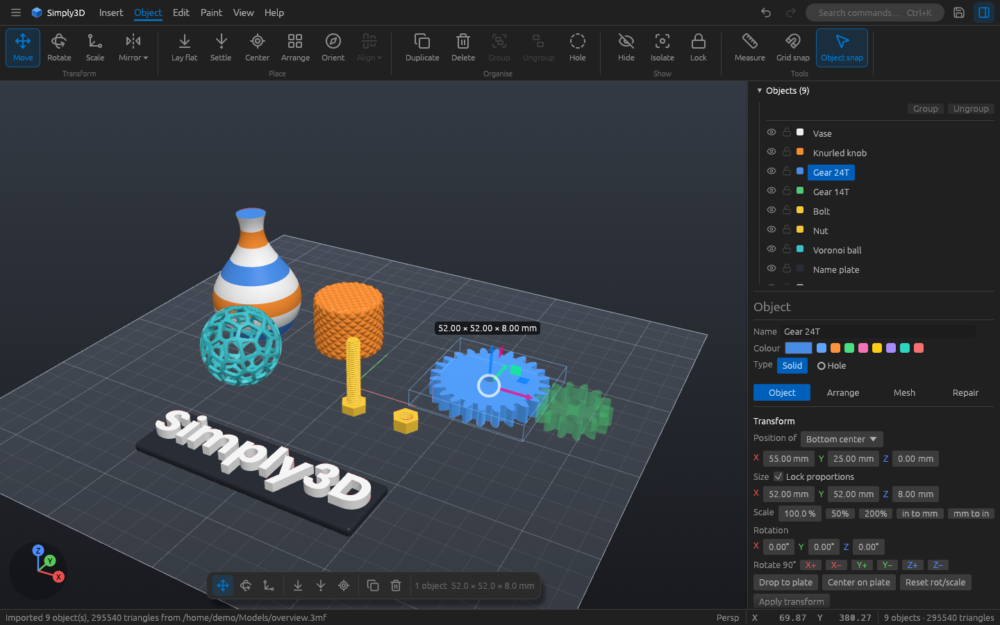
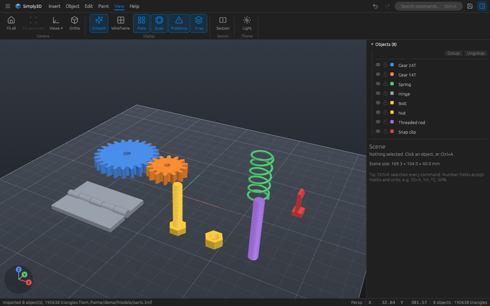
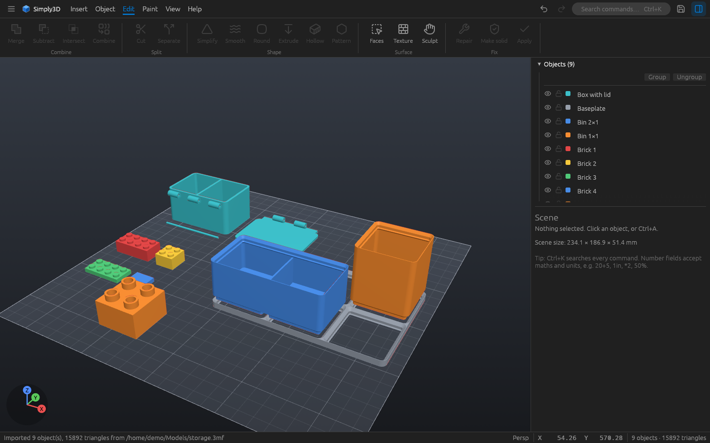
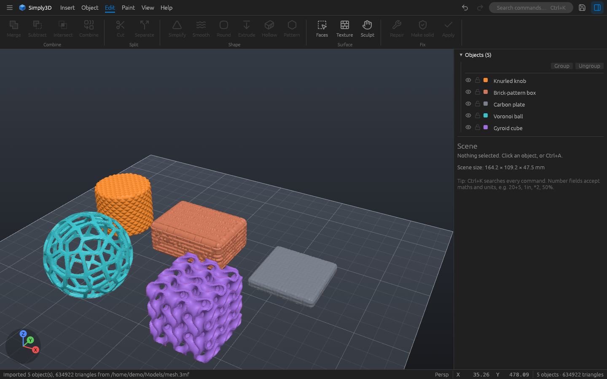
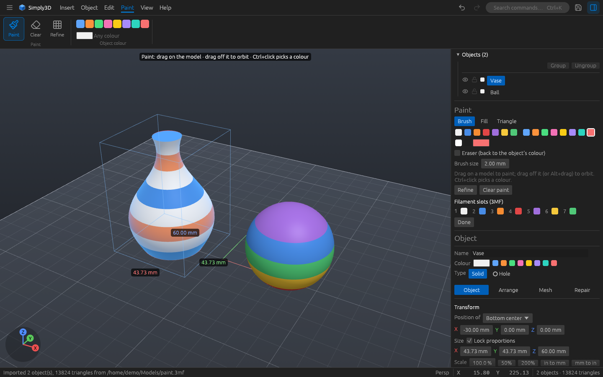

# Simply3D

**Simple, fast 3D modelling for 3D printing.**

Simply3D is a free remake of Microsoft 3D Builder, written in Rust. It keeps 3D Builder's simple tab-and-ribbon way of working and adds the precision, repair, painting and sculpting tools 3D Builder never had. It's one portable program for Windows and Linux: nothing to install, and it handles models with millions of triangles.



## Download

Get it from the [Releases](https://github.com/p3tr0s/Simply3D/releases) page.

**Windows:** download `Simply3D-windows-x64.zip`, unzip it and run `simply3d.exe`. It works on 64-bit Windows 10 and 11 with DirectX 12 or Vulkan.

**Linux:** download `Simply3D-linux-x64.tar.gz`, then:

```bash
tar xzf Simply3D-linux-x64.tar.gz
cd Simply3D
./simply3d          # run it straight away, or
./install.sh        # add it to your applications menu (no root needed; ./install.sh --uninstall removes it)
```

It runs on 64-bit distros from 2022 on (Ubuntu 22.04+, Debian 12+, Fedora 36+, Mint 21+, Arch and others), on Wayland or X11, and needs a Vulkan graphics driver (see the notes under [Build from source](#linux)).

Open models from the ☰ menu, drag files onto the window, or pass them on the command line: `simply3d part.stl project.3mf`.

## Features

### Files
- **Open:** STL (text and binary), OBJ with MTL colours, PLY, 3MF, and pictures (PNG, JPG, BMP, TGA, GIF, WebP).
- **Save and export:** 3MF projects, STL, OBJ and PLY, or just the selected objects.
- **Print (Ctrl+P):** one window that checks the plate before you print (parts off or below the plate, too big for the printer, open meshes, overhangs that need supports, thin walls), with a one-click fix for each, then **opens the plate in your slicer**. It finds Bambu Studio, OrcaSlicer, ElegooSlicer, PrusaSlicer, UltiMaker Cura, Creality Print and others, or uses the app your computer opens 3MF files with.
- **Slicer projects:** reads and writes Bambu Studio, OrcaSlicer and PrusaSlicer 3MF files, keeping objects, parts, colours, painted areas and negative parts.
- 3MF files carry a **thumbnail**, so Windows Explorer and slicers show a preview.
- Recent files, autosave and crash recovery.

### Shapes and generators
- **Basic shapes:** cube, cylinder, cone, sphere, torus, tube, pyramid and wedge. Cubes and cylinders take exact rounded or chamfered edges.
- **Text:** any installed font, several lines, with height, depth, spacing and alignment. Place it on the plate, or **emboss or engrave** it onto any face, wrapping around curved surfaces.
- **Pictures to 3D:** outline, height map, edge, stamp or **lithophane**. Place a picture on the plate, or emboss or engrave it onto a face.
- **Threads:** bolts, nuts, threaded rods, tubes and tapped holes. Pick a standard size (metric M2–M24 or UNC #4–1/2") or make your own: any diameter and pitch; V, trapezoidal, square, buttress, rounded, or a printable 45° profile that needs no supports either way up; custom depth; multi-start; left- or right-hand. Bolts get hex, socket, countersunk, round or knurled heads and an optional plain shank; nuts can be hex, square, round or knurled, with a closed top for caps. A clearance setting makes printed parts screw together.
- **Screw-on lids:** a jar lid and matching threaded neck, ready to customise.
- **Mechanical parts:** involute gears, compression springs, print-in-place hinges and snap-fit clips.
- **Boxes with lids:** snap, slide or hinged lids, with dividers and a fit clearance.
- **Modular storage:** grid-based storage bins, with an optional stacking lip, compartments and magnet pockets, plus matching baseplates.
- **Building bricks:** studded bricks, plates and smooth tiles in two sizes, with fit settings so printed parts click together.
- **Click to place:** new shapes follow the pointer and stand on whatever face you click, or press C (or **Plate centre**) to drop them in the middle of the plate. Settings can make every new shape go straight to the centre or beside the others.
- **Edit them later:** select a generated part (gear, bolt, box, bin, brick…) and change its settings in the side panel; it rebuilds in place. The settings are saved in your 3MF projects.





### Arrange and edit
- Move, rotate and scale with the mouse or the gizmo, with **snapping** to grid steps and to other objects (guides show what lines up).
- **Exact values everywhere:** position, size in mm (with locked proportions), scale %, rotation. Number fields accept maths and units (`20+5`, `1in`, `*2`, `50%`).
- **Type a distance while dragging** for an exact move, or nudge with the arrow keys.
- Align, distribute, mirror, lay flat on a face, drop to plate, centre on plate, and **bake** rotation and scale into the shape.
- **Arrays:** grid copies, or **circular** copies around a centre (spokes, bolt circles, petals), with an outline of where each copy will go before you create them.
- **Auto-arrange** packs parts on the plate; **auto-orient** turns parts for the least overhang.
- Groups, hide, isolate and lock. Unlimited undo and redo.

### Combine and cut
- **Merge, subtract and intersect** with a robust boolean engine that runs in the background.
- **Holes:** turn any object into a hole that cuts live as you move it. Save it as a negative part for the slicer or as a finished cut.
- **Cut with a plane**, with optional **pegs or dowels** so the halves fit back together.
- **Split to fit the printer:** a model too big for your printer is cut into pieces that fit (turned if that saves pieces), with pegs or dowels, and laid out ready to print.
- **Combine** objects into one without a boolean, **separate** an object into its loose parts, or separate selected faces.

### Mesh tools
- **Analysis and repair:** finds open edges, holes, non-manifold edges, flipped faces and loose parts, and fixes them in one click. Shows volume and surface area.
- **Make solid:** rebuilds a broken scan or messy mesh as one clean closed solid, or thickens open surfaces into a shell.
- **Simplify** to fewer triangles while keeping the shape and sharp edges.
- **Smooth:** subdivide, relax or refine, with sharp edges kept.
- **Round edges:** fillets on any closed mesh, outside, inside or both.
- **Hollow** with a wall thickness and drain holes.
- **Extrude down** to the plate, for flat bases and simple supports, threaded parts included.
- **Face tools:** select an area and extrude it, flatten it, smooth it, paint it, copy it as a solid, delete it, or lay the model flat on it.
- **Patterns:** Voronoi cells, wireframe struts and gyroid lattices.
- **Textures:** knurl, ribs, bumps, grid, bricks, carbon fibre, wood grain, leather, waves, sand, or your own picture, pressed into the surface as real geometry.



### Paint and sculpt
- **Paint** colours onto models for multi-material printing, with a brush, fill or single triangles and an eraser. Paint survives booleans, repairs and mesh tools, and is saved in Bambu, Orca and Prusa formats.
- **Sculpt** with draw, inflate, smooth, flatten and grab brushes, with mirroring and automatic detail under the brush.



### View and measure
- Perspective or orthographic view, view presets, and a clickable axis indicator.
- **Smooth shading**, **wireframe**, **section view** and X-ray. Open or inside-out surfaces show in red.
- **Print check:** colours **overhangs**, **thin walls** and **islands** (spots that start in mid-air) so you can fix or support them before slicing. Set the overhang angle and the thinnest wall for your nozzle.
- **Printer presets** (Bambu Lab, Elegoo, Prusa, Creality, Anycubic and more) set the plate size and build height, with warnings for parts off or below the plate.
- **Measure** distances, angles, the gap between faces, and hole or pin diameters. Scale a model to a measured size, or add a tube or channel between two points.
- Stays responsive on multi-million-triangle models.

### Comfort
- 3D Builder-style ribbon with **Insert, Object, Edit, Surface, View and Help** tabs.
- **One place for everything:** the ribbon holds the actions, the bar under the view holds the settings of whatever you're doing (with a live preview), and the side panel shows what's selected: its settings, position and size, and its health.
- **Command search** (Ctrl+K) finds any action by name.
- Notices tell you what just happened, with **Undo** right there. Right-click menus, progress bars with cancel, and preview before applying.
- Dark and light themes.
- **Update check:** once a day at start-up Simply3D asks GitHub for the latest release and shows a button when a new version is out (turn it off in Settings; nothing else is sent). Help → Updates checks right away.

## Keyboard and mouse

| Input | Action |
|---|---|
| Left-drag on an object | Move it (Alt: up/down, Shift: lock axis) |
| Left-drag on empty space | Orbit |
| Shift + left-drag | Box select |
| Right or middle drag | Pan |
| Wheel | Zoom toward the cursor |
| Double-click | Set the orbit centre |
| W / E / R | Move / rotate / scale |
| M / L / T / P / S / B | Measure / lay flat / text / paint / select faces / sculpt |
| A | Auto-arrange |
| D | Drop to plate |
| F / Home | Frame the selection / everything |
| 1 / 3 / 7 / 0 | Front / right / top / iso view |
| O | Orthographic on or off |
| X | Section view |
| Shift+S / Shift+W | Smooth shading / wireframe |
| H / Shift+H / I | Hide / show all / isolate |
| Ctrl+G / Ctrl+Shift+G | Group / ungroup |
| Ctrl+L | Lock |
| Ctrl+P | Print: check the plate, open it in your slicer |
| Arrows, Page Up/Down | Nudge (Shift ×10, Alt ×0.1) |
| Type a number while dragging | Exact move (`25`, `10,5`, `1,2,3`) |
| Ctrl+Z / Ctrl+Y | Undo / redo |
| Ctrl+D / Del / Ctrl+A | Duplicate / delete / select all |
| Ctrl+N / Ctrl+O / Ctrl+S | New / open / save |
| Ctrl+K | Command search |
| Esc | Cancel, leave the tool, clear the selection |

## Build from source

### Windows

1. Install Rust from <https://rustup.rs>.
2. Run `build.bat`, or:

```bat
cargo build --release
target\release\simply3d.exe
```

### Linux

To build it yourself instead of using the download:

1. Install Rust:

```bash
curl --proto '=https' --tlsv1.2 -sSf https://sh.rustup.rs | sh
source ~/.cargo/env
```

2. Install the build tools and window-system libraries:

```bash
# Debian / Ubuntu / Mint
sudo apt install build-essential git libxkbcommon-dev libwayland-dev libx11-dev libxcursor-dev libxi-dev libxrandr-dev mesa-vulkan-drivers

# Fedora
sudo dnf install gcc git libxkbcommon-devel wayland-devel libX11-devel libXcursor-devel libXi-devel libXrandr-devel mesa-vulkan-drivers

# Arch (pick the Vulkan driver for your GPU: vulkan-radeon, vulkan-intel or nvidia-utils)
sudo pacman -S base-devel git libxkbcommon wayland libx11 libxcursor libxi libxrandr vulkan-icd-loader vulkan-radeon
```

3. Build and run:

```bash
git clone https://github.com/p3tr0s/Simply3D.git
cd Simply3D
./build.sh                           # builds, then runs it; or: cargo build --release
./target/release/simply3d model.stl  # run it again later
```

To update later: `git pull`, then `./build.sh` again.

Notes for Linux:

- Simply3D draws with **Vulkan**, so it needs a working Vulkan driver (`vulkaninfo` from `vulkan-tools` checks it). Without a GPU driver, Mesa's software Vulkan (lavapipe) works, but slowly.
- It runs on both **Wayland** and **X11**.
- Open and Save use your desktop's file picker through **xdg-desktop-portal**. GNOME, KDE and most desktops have it; on a bare window manager, install `xdg-desktop-portal` plus `xdg-desktop-portal-gtk` or `-kde`.

### Releases

Releases publish themselves: change `version` in the top-level `Cargo.toml`, add the notes as `release-notes/vX.Y.Z.txt`, and push. Once the Windows and Linux builds pass, GitHub Actions creates the `vX.Y.Z` tag and the release with both downloads.

### Tests and layout

`cargo test --workspace` runs the tests. The code is split into `s3d-core` (geometry, file formats, booleans, repair; no UI) and `s3d-app` (the egui + wgpu desktop app).

## License

Simply3D is free software under the [GNU General Public License v3.0 or later](LICENSE). Icons are from [Lucide](https://lucide.dev) (ISC). Booleans use [boolmesh](https://crates.io/crates/boolmesh) (MPL-2.0).

Microsoft 3D Builder is a trademark of Microsoft. Simply3D is an independent project and isn't affiliated with or endorsed by Microsoft. Other names may be trademarks of their owners.
